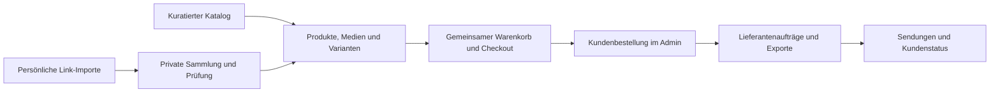

# Fashion Supply: Analyse und Implementierungsplan

Historischer Analyseplan. Aktueller Implementierungs- und Prüfstatus: [COMMERCE-STATUS.md](COMMERCE-STATUS.md).

Stand: 4. November 2026. Grundlage: statische Analyse des aktuellen Repositorys einschließlich TypeScript, Python-Scraper, SQL-Initialisierung, Shop- und Profiloberflächen sowie vorhandener Tests. Ergänzend lesende SSH-Prüfung der VPS-Container, Docker-Anbindung und PostgreSQL-Tabellen-/Rechtemetadaten; keine Kundendatensätze abgefragt, keine Serveränderungen, keine Live-Scrapes und kein visuelles Browser-Audit. Dieses Dokument plant die Umsetzung; die beschriebenen Änderungen sind noch nicht implementiert.

## 1. Ziel und verbindliche Produkteigenschaften

Fashion Supply wird ein Fashion-Shop mit zwei gleichwertigen Einstiegen: kuratierte Shop-Produkte entdecken oder eigene Produktlinks importieren. Beide Wege führen über ein gemeinsames Produkt-, Varianten-, Preis- und Bestellsystem in die zentrale Administration.

- Jeder angemeldete Nutzer kann weiterhin Yupoo-/Weidian-Links scrapen, Ergebnisse dauerhaft in seinem Konto speichern und bestellen. Auch persönliche Mehrfachimporte gehören dazu.
- Persönliche Importe bleiben zunächst privat. Eine Veröffentlichung im Shop ist ein eigener, vom Admin geprüfter Vorgang.
- Jedes Produkt hat eine Kachel und eine Detailseite mit Galerie, belastbaren Produktinformationen und tatsächlich auswählbaren Varianten.
- Unvollständige Importe dürfen gespeichert und zur Prüfung eingereicht werden. Ein verbindlicher Kauf benötigt einen bestätigten Preis und eine eindeutig bestellbare Variante.
- Alle Kundenbestellungen erscheinen in derselben Administration. Lieferantenaufträge werden daraus separat erzeugt und bis zur Lieferung nachverfolgt.
- Bestehende Konten, individuelle Gebühren, gespeicherte Artikel, Freigaben und Fashiongram-Verknüpfungen bleiben erhalten.

Planungsannahmen: Der Betreiber kauft zunächst nach Kundenbestellung beim Lieferanten ein; es wird kein eigener Lagerbestand vorausgesetzt. Der Katalog bleibt zunächst wie heute angemeldeten Nutzern zugänglich. Öffentliche Produktseiten sind eine spätere, gesondert aktivierbare Erweiterung. Die erste Ausbaustufe erzeugt prüfbare Lieferantenexports; automatischer Versand an Lieferanten wird erst nach Festlegung des Kanals umgesetzt.

## 2. Was bereits existiert

| Bereich | Vorhandene Grundlage | Bewertung |
| --- | --- | --- |
| Anwendung | Next.js 15, React 19, TypeScript, Tailwind, Radix/shadcn-Komponenten | Weiterverwenden; kein Framework-Wechsel erforderlich |
| Datenbank | PostgreSQL über postgres-js und Drizzle; Tabelleninitialisierung in `schema-init.ts` | Nutzbar, aber versionierte Migrationen und präzisere Datentypen nötig |
| Benutzer | Cookie-Sessions, Passwort- und E-Mail-Anmeldung, Admin-/Friend-Rollen, individuelle Gebühren | Grundlage vorhanden; Rechteprüfungen systematisch testen |
| Persönliches Scraping | `/api/scrape` und `/api/items`, persönliche Liste und bisheriger Einreichungsweg | Erhalten und in den gemeinsamen Bestellweg überführen |
| Katalog | `products`, Admin-Pflege, Suche, Kategorien-/Markenfilter im Backend, Gender-Filter | Shop-Grundgerüst vorhanden |
| Storefront | `/shop`, `/shop/product/[id]`, Produktkacheln und einfache Detailansicht | Aktuell nur ein Bild; keine belastbare Variantenstruktur |
| Checkout | `cart_items`, `orders`, `order_items`, serverseitige Summen und Positions-Snapshots | Ausbaufähige Grundlage, mehrere Korrektheitslücken |
| Administration | `/admin/products`, `/admin/orders`, Statuspflege, Lieferantengruppen und Excel-Export | Für Lieferantenbeschaffung erweitern |
| Automatische Importe | Lieferantenquellen, Scheduler im Next.js-Prozess, Python/FastAPI-Sidecar, TS-Fallback | Importlogik und Job-Ausführung überarbeiten |
| Social/Profile | Fashiongram, öffentliche Handles, Posts und gespeicherte Inhalte | Bestehende Referenzen bei Migration berücksichtigen |

Die lokale SQLite-Datei ist kein Beleg für die aktive Datenhaltung: `src/lib/server/db.ts` verwendet PostgreSQL. SQLite und Python-Altdaten sind Migrationsbestände.

### Verifizierte Betriebsumgebung: selbst gehostetes Supabase auf dem VPS

Der Betreiber verwendet den VPS `217.154.21.251`, SSH mit `ssh -i ~/.ssh/id_ed25519 root@217.154.21.251`. Anwendung unter `/opt/fashion-supply`, Supabase-Verzeichnis unter `/opt/supabase`. Die laufenden Container heißen unter anderem `fashion-supply-app-1`, `fashion-supply-scraper-1` und `supabase-db`. Die App hängt am Docker-Netz `supabase_default`; `/data` ist als persistenter Mount vorhanden. Die Tabellen `users`, `sessions`, `items`, `products`, `cart_items`, `orders`, `order_items` wurden in der PostgreSQL-Datenbank `postgres` im Schema `public` bestätigt.

**Architekturentscheidung:** Bestehendes selbst gehostetes Supabase weiterverwenden. Keine neue Cloud-Datenbank und kein Ersatz der Installation. Drizzle greift bereits direkt auf dessen PostgreSQL zu. Authentifizierung verwendet derzeit die eigenen Anwendungstabellen und Cookie-Sessions; die vorhandenen Supabase-Auth-/Storage-Dienste sind davon zu unterscheiden.

- Für die erste Shop-Ausbaustufe bestehende Authentifizierung kompatibel erhalten. Eine spätere Migration zu Supabase Auth braucht ein eigenes Mapping von numerischen Nutzer-IDs auf Auth-IDs, eine Session-/Passwortstrategie und Rechte-Policies; keine beiläufige Umstellung während der Produktmigration.
- Supabase Storage kann die neue Medienablage übernehmen: öffentliche, freigegebene Shop-Bilder und private Importbilder in getrennten Buckets; private Bilder nur über autorisierte Backend-Zugriffe oder kurzlebige signierte URLs. Die bestehenden App-Sessions sind nicht automatisch Supabase-JWTs. Alte `/images`-Referenzen kontrolliert migrieren und zunächst kompatibel bedienen.
- Geschäftsdaten weiter über das Next.js-Backend ausliefern. Browser erhalten keine privilegierten DB-/Service-Schlüssel. Einen eigenen, möglichst eingeschränkten DB-Nutzer für die Anwendung vorsehen; Schemaänderungen mit gesonderten Migrationsrechten ausführen.
- Staging und Integrationstests auf einer isolierten PostgreSQL-/Supabase-Umgebung ausführen; kein Test-Signup und keine automatische Schema-/Datenmigration gegen die laufende Produktionsdatenbank.
- Supabase Realtime befand sich beim Container-Snapshot in einer Neustartschleife. Ursache nicht untersucht. Der Shop darf für Bestellkorrektheit und Importfortschritt zunächst nicht von diesem Dienst abhängen.

**Zusätzlicher P0-Befund aus den DB-Metadaten:** Für die sieben geprüften Anwendungstabellen ist Row Level Security deaktiviert. Die Rollen `anon` und `authenticated` besitzen SELECT-Rechte auf den zusätzlich geprüften Tabellen `users`, `sessions`, `items`, `products`, `orders`. Ob diese Tabellen über den extern erreichbaren REST-Dienst tatsächlich abrufbar sind, wurde nicht getestet. Vor der Shop-Freigabe API-Exposition, weitere Schreibrechte und Grants vollständig prüfen; interne Tabellen aus dem API-Zugriff nehmen bzw. Rechte entziehen, und gezielt exponierte Daten durch passende Policies absichern. Bestehende Custom-Cookie-Authentifizierung liefert dabei nicht automatisch eine Identität für `auth.uid()`; RLS-Policies müssen zur gewählten Zugriffsarchitektur passen. Auf dem VPS wurden keine Rechte geändert.

## 3. Konkrete Lücken und Risiken im aktuellen Code

### P0: Vor einem produktiven Shop-Checkout beheben

1. **Zwei getrennte Bestellwelten.** Persönliche Importe werden in `items` gespeichert; `/api/cart/submit` ändert dort nur `stage` und `orderStatus`. Shop-Bestellungen entstehen dagegen aus `cart_items` in `orders` und `order_items`. Ein persönlicher Import wird dadurch nicht automatisch zu einer Shop-Bestellung.
2. **Unvollständige Produkte können durch den Checkout gelangen.** `checkout()` lädt `products.active`, prüft diesen Wert aber nicht. `priceLine(null, ...)` liefert eine Positionssumme von 0; der Checkout lehnt fehlende Preise nicht ab. Varianten werden nicht gegen verfügbare Kombinationen geprüft.
3. **Warenkorb verwechselt Farben.** `addToCart()` und der Unique-Index identifizieren Positionen über Nutzer, Produkt und Größe, ohne Farbe. Zwei verschiedene Farben derselben Größe werden zusammengeführt. Ziel: Identifikation über echte Varianten-ID.
4. **Checkout ist nicht gegen parallele Verarbeitung abgesichert.** Warenkorb und Preise werden vor der Transaktion gelesen. Zwei Requests können dieselben Positionen bestellen; zwischenzeitlich hinzugefügte Positionen können beim pauschalen Leeren verschwinden. Idempotenz, Sperren und eine Warenkorbversion fehlen.
5. **Preise persönlicher Artikel sind nicht vertrauenswürdig.** `/api/items` übernimmt `price_cny` vom Client. Diese Eingabe darf künftig eine Schätzung sein, aber niemals ungeprüft die verbindliche Checkout-Grundlage.
6. **Unsichere Migrationsannahmen.** `scripts/migrate-legacy-orders.ts` macht aus allen eingereichten Altartikeln je Nutzer eine Bestellung mit Status `paid`. Es nutzt aktuelle Gebühren, berücksichtigt keine vollständige historische Zahlungsprüfung und übernimmt individuelle Artikelgebühren nicht über dieselbe Auflösung wie `enrichItem()`. Dieses Skript nicht unverändert ausführen.

### P1: Datenmodell und Betriebsabläufe

7. **Ein Foto wird ein Produkt.** `scrapeAlbumToProducts()` ruft für jedes Albumfoto `upsertPhotoProduct()` auf. Es entstehen Produkte mit `album#photo` als Quelle, häufig ohne Preis. Verschiedene Ansichten, Größentabellen und Detailbilder dürfen keine eigenständigen Kaufartikel sein. Umgekehrt können Sammelalben mehrere echte Produkte enthalten: pauschal ein Album = ein Produkt wäre ebenfalls falsch.
8. **Galeriedaten fehlen durchgängig.** Sidecar und TS-Scraper geben im normalen Weg ein Titelbild zurück; Schema, Typen und Detailseite besitzen keine Galeriebeziehung. Ein neues Galerie-Frontend allein löst das nicht.
9. **Taxonomien widersprechen sich.** Heuristisches Scraping liefert z. B. `Hoodie & Sweats`, KI-Kategorisierung `Tops` plus `Hoodie`. Kategorien, Größen, Marken und Farben sind überwiegend Freitext. Die Storefront bietet derzeit vor allem Suche und Gender, obwohl die API weitere Filter kennt.
10. **Persönlicher Bulk-Import passt nicht zur API.** Die Startseite sendet `urls` und `stage` an `/api/scrape/bulk`; diese Route ist Admin-only, ignoriert `stage` und schreibt in den globalen Katalog. Persönliche Bulk-Importe benötigen einen eigenen Vertrag.
11. **Statuspflege hat keine Zustandsregeln.** Der Admin kann beliebig zwischen zulässigen Bestellstatus springen; Positionsstatus sind freie Strings. Bei `item_updates` wird nur nach Positions-ID aktualisiert, ohne Bindung an die Bestellung aus dem URL-Pfad. Kein Nachweis einer Kundenrechte-Eskalation, aber eine konkrete Inkonsistenz im Admin-Endpunkt.
12. **Zahlungsdaten sind unvollständig modelliert.** Aktuell Wallet-Adresse, Währung und optional TXID plus manuelle Bestätigung. Es fehlen eigene Zahlungsversuche, ein verbindlicher Crypto-Betrag mit Netzwerk und Ablaufzeit sowie eine nachvollziehbare Bestätigungshistorie. Der QR-Code behandelt USDT nicht als eigenständigen Token-/Netzwerkfall.
13. **Geld und Zeit sind vereinfacht gespeichert.** `DOUBLE PRECISION` für Beträge und `TEXT` für viele Zeitpunkte. Ziel: Cent-/Fen-Beträge oder exakte Dezimalzahlen, explizite Währungen und `timestamptz`.
14. **Hintergrundaufträge sind nicht dauerhaft.** Scheduler und Locks leben im Next.js-Prozess. Neustarts und mehrere Instanzen brauchen persistierte Jobs, atomare Claims, Wiederholungen und Laufzeitbegrenzungen.
15. **Netzwerkschutz ist nicht einheitlich.** Der normale TS-Scraper besitzt Host-/DNS-/Redirect-/Größenprüfungen; Lieferanten-Scraper und KI-Bilddownload verwenden teilweise direkte Fetch-Aufrufe. Alle externen Abrufe auf denselben geprüften Mechanismus vereinheitlichen.
16. **Datenbankdefinitionen sind verteilt.** Typed Drizzle-Schema und imperative SQL-Initialisierung bilden nicht dieselben Informationen ab; einige Unique-Indizes stehen nur in `schema-init.ts`. Quelle-Deduplizierung existiert bereits, muss aber als atomarer Upsert statt Select-then-Insert benutzt werden.
17. **Profil und Shop sind strukturell gekoppelt.** Die Startseite hat 2.485 Zeilen; Fashiongram liest und referenziert `items`. Ein Löschen der alten Tabelle würde Profilfunktionen beschädigen.

## 4. Zielarchitektur

Den bestehenden Next.js-/PostgreSQL-Stack als modularen Monolithen weiterentwickeln. Shop, persönliches Konto und Administration erhalten eigene Oberflächen; Geschäftsregeln liegen in gemeinsam genutzten Servermodulen. Der Python-Scraper bleibt als Adapter für externe Quellen erhalten.

Module: `catalog`, `imports`, `collections`, `pricing`, `checkout`, `orders`, `payments`, `procurement`, `fulfillment`. Kleine, klare Servicefunktionen mit validierten Eingaben und expliziten Ausgabeobjekten. Bestehende API-Pfade zunächst durch Adapter weiter unterstützen; alte Schreibwege nach dem Umstieg abschalten.

Hintergrundarbeit läuft in einem separaten Worker. Zum Start reicht eine PostgreSQL-Jobtabelle mit atomarem Claim, Lease/Heartbeat, Retry-Backoff, Fehlerablage und Limits pro Nutzer/Quelle. Redis oder eine zusätzliche Suchplattform erst bei belegtem Bedarf einführen. Import, Bildverarbeitung, Kategorisierung und Benachrichtigungen dürfen keinen langen Web-Request voraussetzen.

## 5. Geplantes Datenmodell

| Entität | Aufgabe und wesentliche Regeln |
| --- | --- |
| `products` | Redaktioneller Artikel mit Titel, Beschreibung, Marke, Slug, Sichtbarkeit, Eigentümer bei privaten Produkten und Veröffentlichungsstatus |
| `product_variants` | Konkrete Kombination aus Größe und Farbe, SKU, Preisstatus und Verfügbarkeitsstatus; Eindeutigkeit je Produkt und Optionskombination |
| `product_media` | Mehrere Bilder, Sortierung, Titelbild, Alt-Text, Abmessungen, optional Variantenbezug und Medientyp wie Produktfoto oder Größentabelle |
| `categories`, `product_categories` | Hierarchische Kategorien mit stabilen IDs/Slugs; eine Hauptkategorie, optionale weitere Zuordnungen |
| `brands`, `attributes`, `attribute_values` | Normalisierte Marken und filterbare Eigenschaften; keine beliebigen KI-Werte als neue Facetten |
| `suppliers`, `supplier_offers` | Lieferantenkontakte und Beschaffungsangebote mit Quell-ID, Quell-URL, Einkaufspreis, Währung und Prüfdatum; Zugriff beschränkt |
| `import_jobs`, `import_records` | Importbesitzer, Quelle, Status, Rohdaten, Fehler und Provenienz; Rohdaten nur begrenzt aufbewahren |
| `saved_products`, `collections`, `collection_items` | Persönlich gespeicherte Shop-Produkte und Importe, Sammlungen und ausdrückliche Freigaben |
| `quotes`, `quote_items` | Versioniertes Angebot für unbepreiste/private Importe; Preis, Variante, Frist und Annahme dokumentiert |
| `cart_items` | Nutzer, Varianten-ID, Menge; Unique auf Nutzer und Variante; Mengenprüfung auch in der DB |
| `orders`, `order_items` | Kundenauftrag mit unveränderlichen Kauf-Snapshots inklusive Variante, Preis, Gebühren, Wechselkurs, Adresse und Lieferantenreferenz |
| `payments`, `payment_events` | Zahlungsversuch, Methode, Betrag/Währung, Status, eindeutige Referenz und Bestätigungsereignisse |
| `purchase_orders`, `purchase_order_items` | Eigener Auftrag je Lieferant; Kundenbestellpositionen und Mengen eindeutig zugeordnet, Teilmengen möglich |
| `shipments`, `shipment_items` | Ein oder mehrere Pakete mit Carrier, Tracking und enthaltenen Teilmengen |
| `order_events`, `audit_events`, `outbox_events` | Statusverlauf, nachvollziehbare Admin-Aktionen und zuverlässig auslösbare Folgeaufgaben |
| `legacy_mappings` | Eindeutige Zuordnung alter IDs zu neuen Entitäten für wiederholbare Migration und Fashiongram-Kompatibilität |

Sichtbarkeit und Veröffentlichung getrennt modellieren: Ein privates Produkt kann vollständig bestellbar sein, ohne im Katalog aufzutauchen. Veröffentlichte Shop-Produkte erhalten redaktionell geprüfte Felder. Ein privater Import darf bei gleicher Quell-URL niemals die Daten eines anderen Nutzers verändern. Globale Beschaffungsquellen können intern dedupliziert werden; private Notizen, Galerien und Produktbearbeitungen bleiben eigentümergebunden.

Der Besitzer darf seine eigene Import-URL sehen. Bei Shop-Produkten und fremden freigegebenen Produkten bleiben Lieferant, Einkaufskonditionen und Quell-URLs aus Kunden-Responses entfernt. Private Medien benötigen dieselben Zugriffsregeln wie private Produkte; ein erratbarer Dateipfad reicht nicht als Schutz.

Geldregeln: EUR als Cent, CNY als Fen; Wechselkurse als exakte Dezimalwerte mit Zeitpunkt. Eine dokumentierte Rundungsregel für Einzelpreis, Gebühren und Gesamtbetrag. Individuelle Gebührenhierarchie bleibt erhalten. Zahlungsbetrag, Steuern, Versand und Beschaffungskosten getrennt abbilden. Historische Bestellungen werden bei späteren Preisänderungen nicht neu berechnet.

## 6. Kategorien und Suche

Navigation über Damen, Herren und Unisex; Zielgruppe ist eine eigenständige Mehrfachzuordnung, keine Produktkategorie. Gemeinsamer Kategoriebaum, beispielsweise:

- Bekleidung: Oberteile → T-Shirts, Hemden, Hoodies, Sweatshirts, Strick; Hosen → Jeans, Stoffhosen, Shorts, Jogginghosen; Jacken & Mäntel; Kleider & Röcke; Unterwäsche & Socken; Sport- und Bademode.
- Schuhe: Sneaker, Boots, Halbschuhe, Sandalen, Slides.
- Taschen: Rucksäcke, Schultertaschen, Crossbody, Shopper, Reisetaschen, Portemonnaies.
- Accessoires: Mützen & Caps, Gürtel, Schals, Brillen, Schmuck, Uhren.

Filter: Kategorie/Unterkategorie, Marke, Preis, tatsächlich verfügbare Größen, Farbe, Material, Passform und Verfügbarkeit. Schuhgrößen mit Größensystem speichern, nicht mit Kleidungsgrößen vermischen. Farben als normalisierte Filterfamilien plus konkrete Farbbezeichnung des Produkts. Kollektionen wie „Neu eingetroffen“ sind unabhängig von der Taxonomie.

Filterzustand in der URL speichern; Facetten und Trefferzahlen serverseitig unter denselben Sichtbarkeitsregeln berechnen. Größen- und Farbfilter müssen bei kombinierter Auswahl eine tatsächlich existierende Variante treffen. Preise und Preisfilter müssen dieselben nutzerabhängigen Gebühren berücksichtigen wie die Anzeige. Sortierung zunächst nach Neuheit und Preis; keine künstliche „Bestseller“-Behauptung ohne Datenbasis.

Start mit PostgreSQL-Suche und passenden Indizes. KI schlägt Kategorien und Attribute vor, verwendet dabei Kategorie-IDs aus einem vorgegebenen Schema und dokumentiert Modell-/Promptversion. Nicht erkannte Marke, Größe, Material oder Bestand bleiben unbekannt. Fehler, Nicht-Produktbilder und Unsicherheit unterscheiden. Admin-Korrekturen bleiben bei erneutem Scraping erhalten. Die tatsächliche Verfügbarkeit des derzeit fest codierten KI-Modells wurde nicht extern geprüft; Modell konfigurierbar machen und mit einem separaten Integrationscheck verifizieren.

## 7. Kundenoberfläche und persönliche Importe

**Storefront:** klare Kategoriennavigation, mobile Filter, Suchergebnisse mit URL-Zustand und aussagekräftigen Leer-/Fehlerzuständen. Produktkacheln zeigen Titelbild, Marke, Produktname, relevanten Verkaufspreis, verfügbare Farben und Merkfunktion. Keine erfundenen Bewertungen, Rabatte oder Lieferfristen.

**Detailseite:** Galerie mit Vorschaubildern, Zoom, Touch- und Tastaturbedienung; Marke, Titel und Beschreibung; verfügbare Farb-/Größenkombinationen; Größentabelle, Material und Pflege soweit belegt; Preis, Versand und Liefererwartung; Speichern und Warenkorb. Bei fehlendem Preis erscheint „Preis anfragen“. Unverfügbare Varianten werden eindeutig gekennzeichnet. „Ähnliche Produkte“ kann zunächst über Kategorie und Marke ermittelt werden.

**Mein Konto:** Überblick, Meine Importe, Gespeicherte Produkte/Sammlungen, Angebote, Bestellungen und Details, Adressen und Einstellungen. Bestehendes Fashiongram bleibt verknüpft; eine private Importseite wird nicht durch einen öffentlichen Profilpost automatisch veröffentlicht.

**Persönlicher Import:** Link oder mehrere Links → dauerhafter Job → Fortschritt → Rohdaten und alle relevanten Bilder → Nutzer prüft Titel und gewünschte Variante → privat speichern. Bei bestätigtem Preis/Angebot in denselben Warenkorb wie Shop-Produkte legen. Ansonsten im Admin eine Beschaffungs-/Preisanfrage erzeugen und nach Freigabe dem Nutzer ein befristetes Angebot vorlegen. Änderungen am Angebot erfordern eine erneute Annahme.

**Importqualität:** Produktidentität anhand externer Artikel-ID, SKU, Albumstruktur und Metadaten bestimmen. Detailbilder gruppieren, Farbvarianten zuordnen, Größentabellen getrennt behandeln. Sammelalben in der Prüfung auf mehrere Produkte aufteilen. Unsichere Zuordnungen als Entwurf speichern. Keine automatische Veröffentlichung nur aufgrund eines erfolgreich geladenen Fotos.

## 8. Checkout, Zahlung und Bestellabwicklung

Vor dem Kauf prüft der Server Eigentum/Zugriff, Veröffentlichungs- bzw. Angebotsfreigabe, Variante, ganzzahlige Menge, aktuelle Bestellbarkeit und verbindlichen Preis. Lieferantenware ohne verifizierten Lagerbestand wird als Beschaffungsware geführt; keinen erfundenen eigenen Lagerbestand anzeigen. Bei künftigem Eigenlager kommen echte Reservierungen hinzu.

Der Checkout verwendet einen Idempotenzschlüssel und eine Warenkorbversion. Er sperrt den relevanten Warenkorb, liest und validiert Positionen innerhalb der Transaktion, schreibt Order und Snapshots und entfernt nur die verarbeiteten Positionen. Preisänderungen seit der angezeigten Zusammenfassung werden zur erneuten Bestätigung zurückgegeben. Eine wiederholte Anfrage mit demselben Schlüssel liefert denselben Auftrag.

Bestell-, Zahlungs- und Lieferstatus trennen. Beispiele: Auftrag `placed / processing / completed / cancelled`; Zahlung `pending / confirmed / failed / expired / partially_refunded / refunded`; Beschaffung pro Position `pending / ordered / confirmed / unavailable / received`; Versand aggregiert aus tatsächlichen Paketen. Erlaubte Übergänge definieren und als Ereignisse protokollieren. Ein TXID-Eintrag ist kein Zahlungsnachweis.

Den bestehenden manuellen Crypto-Weg zunächst korrekt abbilden, sofern er beibehalten wird: Währung, konkretes Netzwerk, exakter Zahlbetrag, Kurs-/Angebotsfrist, Unter-/Überzahlung und dokumentierte Bestätigung. Kartenzahlung oder andere Methoden können über einen Zahlungsadapter ergänzt werden; Anbieterwahl bleibt offen. Externe Payment-Aufrufe erfolgen außerhalb der Datenbanktransaktion, Wiederholungen und Webhooks werden idempotent verarbeitet.

Die Bestellbestätigung muss auch bei ausstehender Zahlung im Admin sichtbar sein. E-Mail-/In-App-Benachrichtigungen werden nach Commit über die Outbox ausgelöst. Stornierung, Nichtlieferbarkeit, Teilrückzahlung und Rückgabe benötigen eigene nachvollziehbare Vorgänge; ein einfacher Wechsel zurück auf `paid` genügt nicht.

## 9. Administration und Lieferantenübergabe

1. Zentrale Auftragsübersicht mit Suche, Datum, Kunde, Zahlungs-, Beschaffungs- und Versandstatus; persönliche Importanfragen in einer eigenen Prüfansicht.
2. Bestelldetail mit unveränderlichen Kaufpositionen, Kundenadresse, internen Notizen, Zahlungsereignissen und Statushistorie.
3. Beschaffungsprüfung: Lieferant und konkretes Angebot, gewünschte SKU/Größe/Farbe, Stückzahl, Preis und Verfügbarkeit prüfen. Bei Abweichungen zuerst Kundenfreigabe einholen.
4. Lieferantenauftrag erzeugen: Positionen eines oder mehrerer Kundenaufträge nach Lieferant bündeln, interne Kundenbezüge beibehalten, reservierte/offene Mengen verfolgen. Bereits beauftragte Mengen dürfen nicht erneut bestellt werden.
5. Je Lieferantenauftrag eine prüfbare Exportversion mit Beschaffungsnummer, Bild/Artikelreferenz, SKU, Variante, Menge, Einkaufspreis und Quelllink. XLSX und kopierbare Nachricht reichen für den Start. Keine Endkundenpreise, internen Gebühren oder unnötigen Kundendaten exportieren.
6. Übergabe protokollieren: Export erstellt ist nicht gleich gesendet. Versandkanal, Zeitpunkt, Empfänger, Bestätigung und externe Lieferantenbestellnummer dokumentieren. Automatische Übermittlung später über den konkret gewählten Kanal anbinden.
7. Teillieferungen, nicht lieferbare Positionen, Qualitätskontrolle falls genutzt und mehrere Trackingnummern unterstützen. Kunden sehen daraus einen verständlichen Verlauf ohne interne Einkaufskonditionen.

Der vorhandene Seller-Sheet-Export ist Ausgangspunkt. Zusätzlich benötigt werden persistente Lieferantenaufträge, auftragsübergreifende Bündelung, Mengenabgleich und ein Übergabeprotokoll.

## 10. Umsetzung in überprüfbaren Etappen

| Etappe | Konkrete Umsetzung | Fertig, wenn … |
| --- | --- | --- |
| 0 – Absicherung | Isolierte PostgreSQL-Testdatenbank, Restore-Test, versionierte Migrationen; Supabase-API-Exposition und Grants absichern; Checkout-Validierung, Farbfehler, Positionszuordnung und Idempotenz korrigieren | Interne Tabellen nicht unberechtigt per API les-/schreibbar; Nullpreise/deaktivierte Produkte abgelehnt; paralleler Checkout erzeugt höchstens einen Auftrag; fremde Position unter falscher Bestell-ID unverändert |
| 1 – Produktbasis | Produkte, Varianten, Medien, Kategorien, Attribute und Lieferantenangebote ergänzen; Bestandsfelder über Kompatibilitätsadapter lesen | Ein Artikel mit mehreren Bildern und Farb-/Größenkombinationen über API und Admin vollständig pflegbar |
| 2 – Import und Konto | Dauerhafte Importjobs, gemeinsamer TS-/Python-Ausgabevertrag, Galerien, private Eigentumsrechte, Sammlungen und Angebotsprüfung | Nutzer A importiert einzeln und mehrfach, speichert und bestellt; Nutzer B kann private Daten und Medien nicht abrufen |
| 3 – Storefront | Navigation, Kacheln, Detailgalerie, Variantenwahl, Facetten, URL-Filter und responsive Kontoansichten | Mobile und Desktop vollständig bedienbar; Filter und Varianten ergeben konsistente Treffer und Preise |
| 4 – Kauf und Zahlung | Gemeinsamer Warenkorb für öffentliche und private Produkte, exakte Preise, Angebotssnapshots, Adresse, Zahlung und Benachrichtigungen | Gemischte Bestellung landet vollständig im Admin; Wiederholungen/Zahlungsereignisse erzeugen keine Duplikate |
| 5 – Beschaffung | Lieferantenstammdaten, Purchase Orders, Bündelung, Exporte, Übergabeprotokoll, Teilmengen und Sendungen | Eine Bestellung mit zwei Lieferanten lässt sich korrekt teilen; jede Menge und jedes Paket bleibt der Kundenposition zugeordnet |
| 6 – Migration und Freigabe | Trockenlauf, Datenabgleich, Fashiongram-Zuordnung, Feature Flags, Umschaltung und Rückfallverfahren | Keine persönlichen Artikel/Referenzen verloren; keine erfundenen Zahlungen; Summen und Rechte nachgewiesen; vollständiger Pilotauftrag durchgespielt |

Etappen sind vertikale, testbare Lieferpakete; die Galerie sollte bereits in Etappe 1 mit einer minimalen Ansicht prüfbar sein. Die vollständige Gestaltung folgt in Etappe 3. Keine Produktionsumschaltung, bevor Etappen 0–6 und die gewählte Zahlungsart geprüft sind. Zeit-/Budgetschätzung erst nach Bestandsaufnahme der tatsächlichen Datenmengen und Festlegung von Zahlungs- und Versandregeln.

## 11. Migration ohne Datenverlust

- Vorhandene Datenbank und Medien sichern; Wiederherstellung in einer isolierten Umgebung tatsächlich prüfen. Keine Migration allein auf Basis der lokalen SQLite-Datei planen.
- Neue Tabellen und Spalten zunächst ergänzend ausrollen. Migration mit Batch-ID, eindeutigem Mapping, Trockenlaufbericht und kontrollierten Wiederholungen erstellen.
- Bestehende Produkte und `album#photo`-Datensätze inventarisieren. Nur bei belegter gemeinsamer Produktidentität zusammenführen; alte IDs auf neue Produkte/Medien abbilden. Aktive Bestellpositionen behalten ihre ursprünglichen Snapshots.
- Persönliche `items` in private Importe/Produkte, Sammlungen oder explizite historische Vorgänge überführen. Freitextgrößen nicht automatisch zu angeblich bestätigten Varianten machen.
- Alte Bestellgruppen nicht pauschal pro Nutzer zusammenfassen. Herkunft, ursprüngliche Status, Zeitpunkte, Notizen und Gebühren erhalten; unsichere Fälle separat zur Admin-Prüfung markieren.
- Keine Zahlung ohne Nachweis bestätigen. Bereits übernommene historische Beträge nicht nach heutigen Gebühren neu berechnen; fehlende historische Informationen als unbekannt erhalten.
- Fashiongram-Posts, Looks und weitere `item_id`-Beziehungen vollständig inventarisieren und über Mapping/Adapter erhalten. Legacy-Tabelle erst nach Auflösung aller Abhängigkeiten entfernen.
- Vor Umschaltung kurze Schreibpause oder kontrollierte Nachmigration aller Änderungen; keine unkoordinierte doppelte Schreiblogik. Anschließend alte Schreibwege abschalten und nur noch kompatible Lesezugriffe zulassen.
- Abgleichen: Datensatzanzahl, Eigentümer, Bilder, Varianten, Bestellmengen, offene Beschaffung und Geldsummen pro Währung; Abweichungen dokumentiert auflösen.
- Rückfall: Feature Flags plus kompatible Schema-Erweiterungen. Nach neuen realen Bestellungen kein blindes Restore auf den Stand vor Migration, sondern Änderungen erhalten und gezielt reparieren.

## 12. Verifikation und Freigabekriterien

Aktuell geprüft: `npx tsc --noEmit --incremental false` erfolgreich. Vier datenbankunabhängige Bestandstests für E-Mail-Normalisierung, Passwort-Upgrade, Hostprüfungen und Rate-Limits bestanden. Zwei DB-bezogene Tests bewusst nicht ausgeführt: Die Tests setzen noch `FASHION_ORDERS_DB` für SQLite, während der aktive Treiber PostgreSQL verwendet. Ein voller Testlauf wäre damit keine ausreichend isolierte Prüfung. Kein vollständiger Build-/E2E-/Produktivnachweis.

Für die Umsetzung erforderlich:

- Unit-Tests für Gebühren, Cent-/Fen-Rundung, Angebotsfristen und erlaubte Statusübergänge.
- Integrationstests mit isoliertem PostgreSQL für Ownership, private Medien, atomare Upserts, DB-Constraints, Checkout-Sperren, Idempotenz und Migrationen.
- Scraper-Vertragstests gegen gespeicherte HTML-/JSON-Fixtures: Einzelprodukt, mehrere Ansichten, Sammelalbum, Größenbild, fehlender Preis, Fehler und Redirects. Live-Scrapes nur als separate Integrationschecks.
- E2E: persönlicher Import → privat speichern → Angebot freigeben → mit Shop-Produkt kaufen → Admin prüft → zwei Lieferantenaufträge → Teilversand → Kundenansicht.
- Negativtests: Kunde manipuliert Preis/Produkt-ID, liest fremden Import, setzt fremde Warenkorb-ID, wiederholt Checkout oder Zahlungsereignis. Alles ohne unberechtigte Wirkung.
- UI-Prüfung für Tastatur, Fokus, Galerie, Beschriftungen, Kontrast und mobile Layouts; Filterzustand bleibt bei Zurücknavigation erhalten.
- Betrieb: Job kann nach Prozessabbruch fortgesetzt werden; fehlgeschlagene Importe sichtbar wiederholbar; Backups inklusive Medien wiederherstellbar; Fehlerlogs ohne Secrets oder unnötige personenbezogene Daten.
- Vor Verkaufsstart müssen die konkreten Steuer-, Versand-, Rechnungs-, Widerrufs-/Retouren- und Datenschutzanforderungen für Betreiber und Absatzländer fachlich geklärt und im Ablauf umgesetzt werden. Dieses Dokument enthält keine rechtliche Bewertung.

## 13. Entscheidungen vor den jeweils abhängigen Etappen

Für den Start der technischen Grundlagen sind keine weiteren Produktentscheidungen notwendig. Vor Etappe 3: gewünschte Marke/Designsprache und öffentliche oder rein angemeldete Katalognutzung festlegen. Vor Etappe 4: Zahlungsarten, Zielländer, Versandberechnung, Preis-/Gebührenanzeige und verbindliche Liefererwartung klären. Vor Etappe 5: Lieferantenkanäle, Bündelungsregeln und Direktversand oder eigenes Zwischenlager festlegen.

Nicht Teil der ersten Ausbaustufe: autonomer Einkauf bei Lieferanten, zusätzliche Marktplatzverkäufer, personalisierte KI-Empfehlungen oder eine neue Microservice-Plattform. Bestehende Social-Funktionen werden kompatibel gehalten; ihre Ausweitung ist ein separates Vorhaben.
